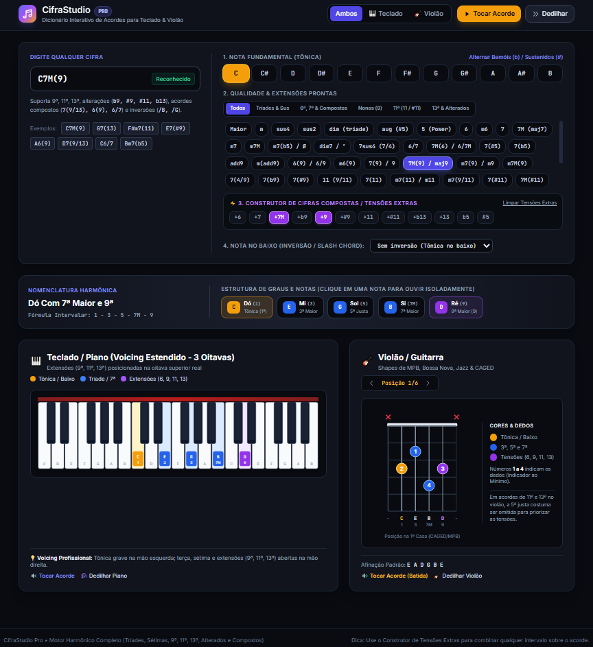

# 🎵 CifraStudio Pro — Dicionário e Visualizador Interativo de Acordes

<p align="center">
  
</p>

<p align="center">
  <a href="https://denis-tek.github.io/cifra-studio/" target="_blank">
    
  </a>
  <a href="https://github.com/Denis-Tek/cifra-studio" target="_blank">
    
  </a>
</p>

---

## 📖 Sobre o Projeto

O **CifraStudio Pro** é uma aplicação web interativa para músicos, estudantes e professores que desejam visualizar, ouvir e compreender a estrutura harmônica de qualquer acorde musical simultaneamente no **Teclado / Piano** e no **Violão / Guitarra**.

Desenvolvido em um único arquivo autocontido (`index.html`), o projeto conta com um motor harmônico completo capaz de interpretar desde tríades básicas até acordes estendidos e alterados de **MPB, Bossa Nova e Jazz** (`9ª`, `11ª`, `13ª`, `b9`, `#9`, `#11`, `b13`, cifras compostas como `6/7`, `6(9)`, `7(9/13)` e inversões de baixo / *slash chords*).

---

## 🚀 Demonstração Online (Live Demo)

Acesse e utilize o aplicativo diretamente pelo navegador através do **GitHub Pages**:

- 🔗 **Link direto do projeto:** [https://denis-tek.github.io/cifra-studio/](https://denis-tek.github.io/cifra-studio/)

---

## ✨ Funcionalidades Principais

- 🧠 **Parser Inteligente de Cifras em Tempo Real:**
  - Digite qualquer cifra diretamente no campo de busca (ex: `C7M(9)`, `F#m7(11)`, `G7(13)`, `E7(#9)`, `A6(9)`, `D7(9/13)`, `C6/7`, `Bm7(b5)`, `G/B`) e veja a montagem instantânea.
  - Diferencia automaticamente barras de acordes compostos (`C6/7`, `D7(9/13)`) de barras de inversão de baixo (`C/G`, `D/F#`).

- ⚡ **Construtor Modular de Tensões Extras:**
  - Combine livremente intervalos de `+6`, `+7`, `+7M`, `+b9`, `+9`, `+#9`, `+11`, `+#11`, `+b13`, `+13`, `b5` e `#5` sobre qualquer acorde para criar e testar *voicings* personalizados.

- 🎹 **Teclado / Piano Interativo de 3 Oitavas (SVG):**
  - Exibe 3 oitavas completas (`C3` a `B5`) com *voicing* aberto real: tônica/baixo na região grave e extensões (`9ª`, `11ª`, `13ª`) posicionadas na oitava superior correta.
  - Diferenciação visual por cores: **Tônica/Baixo** (Âmbar), **Tríade/7ª** (Azul) e **Extensões** (Roxo), com indicação da nota e do grau em cada tecla ativa.
  - Clique em qualquer tecla para ouvir sua nota isoladamente.

- 🎸 **Violão / Guitarra com Múltiplas Posições no Braço:**
  - Diagrama de acordes interativo com indicação de pestanas, cordas soltas, cordas abafadas (`✕`), numeração dos dedos (`1` a `4`), notas e graus resultantes em cada corda.
  - Inclui *shapes* clássicos de **MPB, Bossa Nova, Jazz e sistema CAGED**, além de um gerador algorítmico de posições pelo braço.
  - Clique individualmente nas cordas ou alterne entre as variações de região no braço.

- 🔊 **Síntese de Áudio Realista (Web Audio API):**
  - Sem dependência de arquivos externos de áudio: síntese sonora em tempo real com timbres dedicados para **Piano** e **Violão**.
  - Modos de reprodução: **Tocar Acorde (Bloco / Batida)**, **Dedilhar (Arpejo)** ou audição individual de cada grau/nota.
  - Adaptação inteligente: quando a visualização **🎸 Violão** está selecionada, todos os controles globais reproduzem automaticamente o timbre e o *voicing* do violão.

- 📚 **Painel de Nomenclatura e Teoria Harmônica:**
  - Exibe o nome completo do acorde por extenso em português, a **Fórmula Intervalar** exata e cartões interativos para cada grau da estrutura do acorde.

---

## 🛠️ Tecnologias Utilizadas

- **HTML5 Semântico**
- **Tailwind CSS** (Estilização responsiva e tema Dark Studio)
- **JavaScript (ES6+)** (Motor de teoria musical, parser de cifras e gerador de voicings)
- **SVG Dinâmico** (Renderização vetorial interativa do piano e do braço do violão)
- **Web Audio API** (Síntese polifônica de piano e violão diretamente no navegador)

---

## 💻 Como Executar Localmente

Como o projeto foi construído sem dependências de *build* externas, basta clonar o repositório e abrir o arquivo `index.html` em qualquer navegador moderno:

```bash
# 1. Clone este repositório
git clone https://github.com/Denis-Tek/cifra-studio.git

# 2. Acesse a pasta do projeto
cd cifra-studio

# 3. Abra o arquivo index.html no navegador
```

---

## 👤 Autor

Desenvolvido por **Denis** ([Denis-Tek](https://github.com/Denis-Tek)).

- 🌐 Aplicação Online: [https://denis-tek.github.io/cifra-studio/](https://denis-tek.github.io/cifra-studio/)
- 📦 Repositório: [https://github.com/Denis-Tek/cifra-studio](https://github.com/Denis-Tek/cifra-studio)